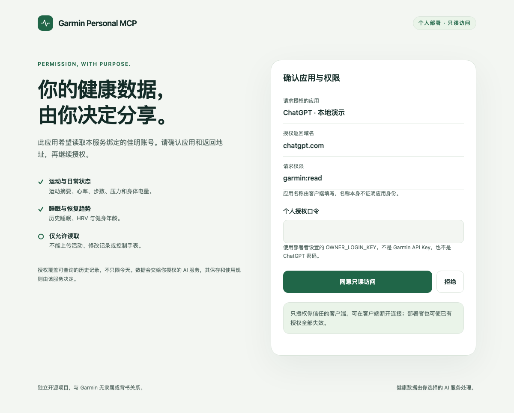
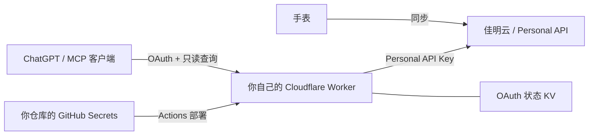

# Garmin Personal MCP

把自己的佳明云健康与运动数据，通过只读 MCP 接入 ChatGPT 或支持远程 MCP 的客户端。

**每个人部署自己的 Cloudflare Worker，使用自己的 Garmin Personal API Key。** GitHub Secrets 保存凭据，GitHub Actions 发布代码和 Worker Secrets。项目作者不托管或接收使用者的健康数据。

[部署指南](docs/DEPLOY.md) · [English](docs/README.en.md) · [安全与隐私](SECURITY.md) · [数据能力](docs/DATA.md)



## 从这里开始

1. Fork 本仓库，或通过 **Use this template** 创建自己的仓库。
2. 准备 Garmin Personal API Key、Cloudflare 账号和一个 OAuth KV namespace。
3. 在自己仓库的 **Settings → Secrets and variables → Actions** 填写下表。
4. 启用 Actions，运行 **Check and deploy → Run workflow**。
5. 打开自己的 Worker 首页，复制 MCP 地址，在 ChatGPT 中选择 OAuth 连接。

完整步骤和最小权限见 [部署指南](docs/DEPLOY.md)。仓库不含可直接访问作者账号的配置。

### 必填 GitHub Secrets

| 名称 | 内容 |
|---|---|
| `GARMIN_PERSONAL_API_KEY` | 自己从 Garmin 获取的 Personal API Key |
| `OWNER_LOGIN_KEY` | 独立随机的个人授权口令，32–256 位字母、数字、`_` 或 `-` |
| `CLOUDFLARE_API_TOKEN` | 仅限部署账号的 Cloudflare API Token |

### 必填 GitHub Variables

| 名称 | 示例 / 含义 |
|---|---|
| `CLOUDFLARE_ACCOUNT_ID` | 自己的 Cloudflare Account ID |
| `OAUTH_KV_ID` | 自己创建的 KV namespace ID，后续更新保持不变 |
| `WORKER_NAME` | `my-garmin-mcp` |
| `PUBLIC_ORIGIN` | `https://my-garmin-mcp.YOUR-SUBDOMAIN.workers.dev`，不带 `/mcp` |
| `DEPLOY_ENABLED` | `true`，显式启用自动部署 |

可选变量：`GARMIN_REGION=cn`（默认，中国区）或 `global`；`AUTH_VERSION=1`；`ENABLE_STATIC_TOKEN=false`（默认）。

> **更新 Key：** 修改 GitHub Secret `GARMIN_PERSONAL_API_KEY`，然后手动运行 **Check and deploy**。只改 Secret 不会触发 Actions。推送或合并到 `main` 会先校验、再部署；拉取请求只校验，不拿部署密钥、不部署。

## 连接 ChatGPT

Worker 首页会自动显示当前部署的地址和连接说明：

- **MCP URL：** `https://你的域名/mcp`
- **认证：** OAuth
- **客户端注册：** 优先 CIMD；也支持动态注册 DCR
- **Client ID / Client Secret：** 留空，由客户端发现或注册
- **授权页口令：** `OWNER_LOGIN_KEY`

Garmin Key 只用于 Worker 访问佳明，不要把它填进 ChatGPT、自定义请求头或授权页。ChatGPT 的自定义 MCP 入口和可用性以账号实际界面为准，参考 [官方连接文档](https://developers.openai.com/plugins/deploy/connect-chatgpt)。

需要静态 Bearer 的客户端，可主动启用 `ENABLE_STATIC_TOKEN=true` 并另设 `MCP_ACCESS_TOKEN` Secret；详见 [部署指南](docs/DEPLOY.md#其他-mcp-客户端)。这不是 Garmin Key，也不是 OAuth Client Secret。

## 能读取多少数据

| 工具 | 内容 | 单次限制 |
|---|---|---|
| `garmin_status` | 服务配置和能力，不查询健康数据 | 不验证 Garmin Key 是否有效 |
| `garmin_daily` | 步数、热量、心率、压力、Body Battery、血氧、呼吸等日汇总 | 指定一天 |
| `garmin_sleep` | 睡眠时长、阶段时长、评分 | 日期范围最多 31 天 |
| `garmin_hrv` | 夜间 HRV、基线和状态 | 日期范围最多 31 天 |
| `garmin_activities` | 运动列表和摘要指标 | 最多 31 天；每页默认 20、最多 50 条 |
| `garmin_activity` | 某次运动的摘要指标 | 按 activity ID 查询 |
| `garmin_series` | 心率、Body Battery、血氧小时均值序列 | 指定一天；每页默认 120、最多 240 点 |
| `garmin_fitness_age` | 佳明健身年龄估计 | 指定日期 |

**31 天是单次跨度，不是“只能查最近 31 天”。** 可以查询更早日期、分段读取更长时间，并沿 `nextOffset` 翻页。最早可追溯时间和字段可用性取决于 Garmin API、设备与已同步数据，不保证完整历史；本项目没有验证所有账号的历史保留边界。

示例提问：

> 分析我最近 90 天的睡眠、HRV 和运动负荷。每段不超过 31 天，运动列表继续翻页直到取完。请注明实际获得的日期、缺失记录和未完成的查询。

当前不是实时手表遥测，也不提供上传、GPS、原始 FIT、完整分圈或全量历史备份。详情见 [数据语义与限制](docs/DATA.md)。

## 数据如何流动



Worker 按需查询，不持久保存健康结果。客户端收到结果后如何保存和使用，由该客户端决定。一个部署绑定一个主人；这不是多人共用的 Garmin 登录服务。

## 本地开发

需要 Node.js 22+。不需要真实健康数据即可运行检查：

```sh
npm ci
npm run types
npm run check
npm test
npm run test:scripts
npm run check:public
npm run build
npm run check:deploy
```

复制 `.dev.vars.example` 为忽略的 `.dev.vars`，自行填入本地配置，然后 `npm run dev`。首页可在 localhost 预览；完整 OAuth 流程需要 HTTPS 和合法回调地址，自动测试使用合成凭据覆盖它。

`wrangler.jsonc` 是通用模板，包含占位 KV ID。生产配置由 `npm run configure` 写入忽略的 `.deploy/`；**不要直接用模板运行 `wrangler deploy`**。`npm run deploy` 校验配置、将代码和 Secrets 一起部署，并清理临时密钥文件。

## 验证与安全边界

- 包含 Workers 运行时 OAuth、PKCE、刷新/撤销、授权版本失效、分页与数据投影测试，以及部署配置验证。
- GitHub 部署后验证首页、发现文档和匿名 401。它不会读取健康数据，也不证明真实 ChatGPT 客户端连接已成功。
- 中国区部署已验证 Personal API 数据读取和真实 ChatGPT 连接；全球区为可配置路径，尚未做真实账号验收。
- OAuth 依赖 Cloudflare 官方库；此项目没有经过独立安全审计。请阅读 [SECURITY.md](SECURITY.md)，特别是密钥轮换、GitHub 写权限和 KV 一致性限制。

## 许可与贡献

MIT。欢迎通过拉取请求改进兼容性和数据覆盖。提交前运行上述检查；不要提交真实健康记录、授权码、密钥或部署备份。依赖更新通过 Dependabot 提出，不自动合并。

这是独立项目，与 Garmin、OpenAI 无隶属或背书关系。Garmin Personal API 的获取和使用资格以 [Garmin 官方说明](https://developer.garmin.com/gc-developer-program/personal/personal-api/) 为准。软件许可不授予 Garmin API 访问权。
